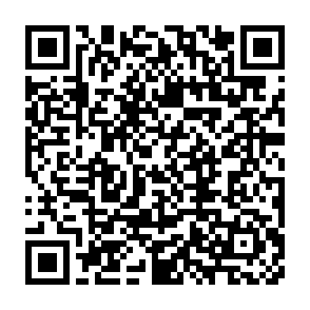

# SHIELD DJ Standard

Lecteur MP3 et OGG pour 3DS, pensé pour Old 3DS et 2DS. Il affiche les pochettes, permet de parcourir la carte SD et propose pitch, profils de basses, réverbération, filtres audio et lecture aléatoire. Le vinyle animé distingue Standard de [SHIELD DJ Lite](https://github.com/Shield-77/Shield-DJ-Lite), qui propose les mêmes fonctions audio dans une interface plus légère.

## Télécharger / Download

**[ShieldDJStandard.cia (v1.0.38)](https://github.com/Shield-77/Shield-DJ-standard-/releases/download/v1.0.38/ShieldDJStandard.cia)** · [Toutes les releases](https://github.com/Shield-77/Shield-DJ-standard-/releases)

Sur une 3DS modifiée, ouvrir FBI > Remote Install > Scan QR Code.

Standard et Lite peuvent coexister (Title ID Standard : `000400000A210300`).

La v1.0.38 rétablit la fonction normale de HOME, déplace Audio Boost dans les options SELECT et améliore le guide et l’organisation des fichiers MP3/OGG. La v1.0.36 ajoutait une réverbération prolongée facultative, désactivée par défaut, et corrige le temps affiché quand le pitch change. Les versions précédentes ont ajouté sept filtres et le réglage tactile de la réverbération. Voir les [notes techniques](DEVELOPMENT.md) pour l'historique détaillé.

## Utilisation

Placez vos fichiers MP3 et OGG sur la carte SD, à la racine ou dans vos propres dossiers. L'application est gratuite.

- Parcourir les dossiers et choisir un MP3 ou un OGG pour lancer la lecture.
- **SELECT** ouvre les options audio. La musique continue pendant la navigation.
- **Y** change le profil de basses ; **X** active ou désactive la lecture aléatoire.
- **L/R** passe à la piste précédente ou suivante. La croix directionnelle règle notamment le pitch pendant la lecture.
- L'écran supérieur affiche la pochette, les informations du morceau et la progression. L'écran inférieur contient la bibliothèque et les commandes.

L'application affiche un guide au premier lancement. Les réglages audio extrêmes peuvent dégrader le rendu sur des fichiers déjà saturés.

## Code source et licences

Le code de la v1.0.36 est dans [`source/`](source/) et [`include/`](include/). Les visuels et polices nécessaires à la compilation sont dans [`assets/`](assets/). Installer devkitPro avec devkitARM, libctru, citro2d/citro3d et les portlibs audio/image, puis lancer `make`. `makerom` et `bannertool` doivent être obtenus séparément ; `MAKEROM` permet de choisir le chemin de makerom. La bannière du **source public** utilise un son silencieux, afin de ne pas redistribuer un effet sonore dont les droits ne sont pas documentés. Le CIA de la release publiée n'est pas modifié.

La licence principale du code est la [GNU GPLv3](LICENSE). Le décodeur minimp3 a sa licence [CC0 séparée](LICENSES/minimp3-CC0.txt) ; les polices ont leurs propres licences dans `assets/fonts/`. Les logos et le nom SHIELD identifient le projet d'origine et ne sont pas accordés par la licence du code. Présenter clairement toute version modifiée comme telle.

## Développement

Le code a été généré avec l'aide d'OpenAI Codex, un assistant de programmation par IA. SHIELD-77 conçoit les fonctionnalités et teste les applications sur console.
